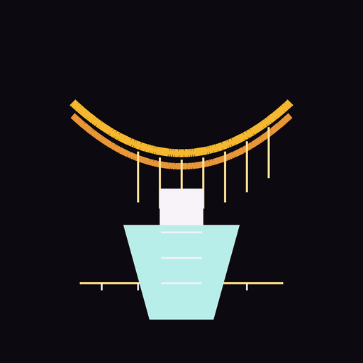

# BridgeLab 🧪

> KAE discovers. Meta-Bridge connects. Vectoreologist maps. MisfitCrew challenges. Keystone preserves. **BridgeLab tests whether the discoveries can survive contact with evidence they have never seen.**

**BridgeLab** is an experimental validation engine that sits *above* the [QMU knowledge ecosystem](https://github.com/meistro57). It asks a single, uncomfortable question:

**Can our discoveries predict meaningful relationships in information the discovery system has never examined?**

This is deliberately *not* another AI agent producing persuasive explanations. It is a reproducible experimental apparatus: it withholds evidence, locks predictions before that evidence is revealed, then measures how well those predictions survive — against real passages *and* against a naive baseline.

## The question

Most knowledge systems are good at *finding* patterns. BridgeLab exists to test whether those patterns are **real** or **confabulated** by the finding process itself.

- Does a "discovery" predict anything about material it was never shown?
- Or is it just re-describing what it already absorbed?

## The pipeline

Seven stages, each inspectable and reproducible:

| Stage | Name | What it does |
|---|---|---|
| A | Evidence Selection | Import findings (JSON/JSONL now, Qdrant via adapter), preserve provenance & lineage. |
| B | Blind Partitioning | Split a corpus ~80% visible / 20% withheld, by whole documents/families (never random chunks), with a reproducible manifest. |
| C | Hypothesis Generation | Generate structured predictions from the visible 80% *only*. |
| D | Prediction Locking | Hash & freeze predictions (model, prompt, params, code, data hash) before any withheld material is revealed. |
| E | Independent Evaluation | Reveal withheld material only to the evaluator; score matches, misses, false positives, contradictions, no-findings. |
| F | Adversarial Review | A MisfitCrew-style critical pass (contamination, bias, shared-vocabulary, correlated sources, causal overreach, overconfidence). |
| G | Reports | Markdown + JSON reports with metrics, citations, limitations — unsuccessful experiments preserved, never hidden. |

## Quickstart

```bash
# Requires Python 3.11+
python3 -m venv .venv
.venv/bin/pip install -e .[dev]

# Run the offline demonstration (no LLM, no network, no Qdrant required)
.venv/bin/bridgelab run --evidence fixtures/demo.jsonl --out runs/demo

# Run the test suite
.venv/bin/python -m pytest -q
```

The demo produces `runs/demo/demo.json` (machine-readable) and `runs/demo/demo.md` (human-readable), and prints the experimental precision vs. baseline.

## Requirements

- Python 3.11+
- No paid LLM calls, no web dashboard, no Qdrant required for the offline demonstration.
- Optional: `pip install 'bridgelab[qdrant]'` for the Qdrant adapter.

## The fixture corpus

`fixtures/demo.jsonl` is **synthetic**, explicitly labelled as such, and contains deliberate test cases: positive (shared-concept families), negative (unrelated material), contradictory (a claim that inverts a known law), and source-leakage (shared-lineage families) so the partitioner's leakage guard is exercised.

## Repository status

This is the **MVP**: the offline validation instrument is real and runnable. The adapters for live KAE / Meta-Bridge / Keystone findings are stubbed behind a clean interface (see [ARCHITECTURE.md](ARCHITECTURE.md) and [ROADMAP.md](ROADMAP.md)).

## Related

- [kae](https://github.com/meistro57/kae) — knowledge archaeology engine
- [meta-bridge](https://github.com/meistro57/meta-bridge) — synthesis/bridge catalog
- [vectoreologist](https://github.com/meistro57/vectoreologist) — embedding topology analysis
- [MisfitCrew](https://github.com/meistro57/MisfitCrew) — critique/mining suite
- [keystone](https://github.com/meistro57/keystone) — evidence preservation

## License

MIT

---

Logo: a bridge arched over an erlenmeyer flask — the discovery bearing its own weight against the unseen evidence it is tested against (by Grommet, the hive's bee).
